# Class Diagram — Stock Prediction (Backend + Model Layer)

Class diagram ini menggambarkan lapisan Domain, Repository, Model (LSTM), dan
Service pada backend `stock_prediction`. Lapisan Frontend (`ui-stock-prediction`)
tidak digambarkan sebagai class diagram karena berbasis React functional
component + hooks (bukan OOP class) — direpresentasikan lewat diagram lain
(mis. sequence/activity diagram) di dokumen skripsi.

```mermaid
classDiagram
    namespace Domain {
        class StockBar {
          +date date
          +float open
          +float high
          +float low
          +float close
          +float volume
        }
        class Headline {
          +date date
          +str title
          +str source
        }
        class SentimentScore {
          +float positive
          +float negative
          +float neutral
          +str label
          +float score
        }
        class DailySentiment {
          +date date
          +float score_mean
          +float score_positive
          +float score_negative
          +str label
        }
        class PredictionResult {
          +str ticker
          +date target_date
          +str direction
          +float probability_up
          +float confidence
        }
        class TrainingRun {
          +str id
          +datetime started_at
          +datetime finished_at
          +str status
          +int epochs_completed
          +int total_epochs
          +float best_metric
        }
        class TickerSymbol {
          +str symbol
          +__str__() str
        }
        class DateRange {
          +date start
          +date end
          +contains(d) bool
          +to_pandas_query() tuple
        }
    }

    namespace Repository {
        class FileBasedRepository {
          <<abstract>>
          +Path raw_dir
          +Path processed_dir
          #_ensure_exists(path) Path
        }
        class StockRepository {
          +load_raw(ticker, date_range) DataFrame
          +load_processed(ticker, date_range) DataFrame
          +save_processed(ticker, df) Path
          +exists_processed(ticker) bool
        }
        class NewsRepository {
          +raw_headlines_path() Path
          +clean_headlines_path() Path
          +load_raw_headlines(date_range) DataFrame
          +load_clean_headlines() DataFrame
          +save_clean_headlines(df) Path
        }
        class SentimentRepository {
          +load_daily_sentiment(date_range) DataFrame
          +save_daily_sentiment(df) Path
          +load_daily_count() DataFrame
          +save_daily_count(df) Path
        }
        class ArtifactRepository {
          +save_lstm_checkpoint(run_id, state_dict) Path
          +load_lstm_checkpoint(run_id) dict
          +load_metadata(filename) dict
          +save_metadata(metadata, filename) Path
          +load_scaler(filename) object
          +save_scaler(scaler, filename) Path
        }
        class LiveDataRepository {
          +upsert_ohlcv(df, fetched_at)
          +load_ohlcv() DataFrame
          +upsert_headlines(df, fetched_at)
          +load_headlines() DataFrame
          +existing_headline_keys() set
        }
    }

    namespace Model {
        class LSTMDirectionClassifier {
          <<nn.Module>>
          +int hidden
          +int num_layers
          +forward(x) Tensor
        }
        class FlexibleLSTMClassifier {
          <<nn.Module>>
          +int hidden_size
          +int num_layers
          +str activation
          +forward(x) Tensor
        }
        class DirectionPredictor {
          +bool is_available
          +predict_proba(X) ndarray
          +predict_latest() dict
        }
        class DatasetBundle {
          <<dataclass>>
          +ndarray X_train
          +ndarray y_train
          +ndarray X_val
          +ndarray y_val
          +ndarray X_test
          +ndarray y_test
          +MinMaxScaler scaler
          +dict capping_bounds
          +list feature_cols
          +int window
          +int horizon
          +dict split_sizes
        }
        class ModelPipeline {
          <<module>>
          +prepare_dataset_bundle(load_fn, cols, horizon, ratios, window) DatasetBundle
          +save_dataset_bundle(bundle, dir, prefix) dict
          +load_dataset_bundle(dir, prefix) DatasetBundle
          +dataset_bundle_status(dir, prefix) dict
          +run_notebook07_training(emit, ...) void
          +run_notebook07_manual_training(emit, config, ...) void
          +predict_latest_notebook07(...) dict
          +backtest_notebook07(split, ...) dict
          +load_trained_notebook07(...) dict
        }
    }

    namespace Service {
        class PredictionService {
          <<service>>
          +get_model_status() ModelInfoResponse
          +predict_direction(ticker) DirectionPredictionResponse
          +run_backtest(split) BacktestResponse
        }
        class TrainingService {
          <<service>>
          +get_skripsi_search_space() SearchSpaceResponse
          +run_skripsi_baseline_stream(req, emit)
          +run_skripsi_finbert_stream(req, emit)
          +run_skripsi_baseline_manual_stream(req, emit)
          +run_skripsi_finbert_manual_stream(req, emit)
          +get_notebook07_result(variant) Notebook07ResultResponse
          +predict_notebook07(variant) Notebook07PredictionResponse
          +backtest_notebook07(variant, split) Notebook07BacktestResponse
        }
        class SentimentService {
          <<service>>
          +run_preprocessing_pipeline_stream(emit)
          +get_pipeline_status() dict
          +get_daily_preview(page, page_size) PreviewResponse
          +get_model_status() dict
        }
        class DataAnalysisService {
          <<service>>
          +get_stock_summary() StockSummaryResponse
          +get_sentiment_daily_aggregation() SentimentDailyAggregationResponse
          +get_combined_pipeline_steps() CombinedPipelineStepsResponse
          +build_combined_dataset(variant, split_mode) DatasetBuildResponse
          +get_dataset_status(variant, split_mode) DatasetStatusResponse
        }
        class DataInformationService {
          <<service>>
          +get_regime_overview(model, horizon) RegimeOverviewResponse
          +get_label_balance(horizon) LabelBalanceResponse
          +get_feature_label_correlation(model, horizon) FeatureLabelCorrelationResponse
          +get_baseline_comparison() BaselineComparisonResponse
          +get_distribution_drift(model, horizon) DistributionDriftResponse
        }
        class LiveDataService {
          <<service>>
          +fetch_live_ohlcv(period) DataFrame
          +fetch_score_and_accumulate_headlines() DataFrame
          +get_live_stock_latest(n) dict
          +get_live_news_latest(n) dict
        }
        class LivePredictionService {
          <<service>>
          +run_live_predict_stream(emit)
        }
    }

    %% ---- Relasi inheritance repository ----
    FileBasedRepository <|-- StockRepository
    FileBasedRepository <|-- NewsRepository
    FileBasedRepository <|-- SentimentRepository
    FileBasedRepository <|-- ArtifactRepository

    %% ---- Repository memakai Value Object ----
    StockRepository ..> TickerSymbol : parameter
    StockRepository ..> DateRange : parameter
    NewsRepository ..> DateRange : parameter
    SentimentRepository ..> DateRange : parameter

    %% ---- Model layer ----
    DirectionPredictor ..> LSTMDirectionClassifier : build & load
    Notebook07Pipeline ..> FlexibleLSTMClassifier : build, train & load
    Notebook07Pipeline ..> DatasetBundle : prepare/save/load

    %% ---- Service -> Repository ----
    PredictionService ..> ArtifactRepository : baca metadata & scaler
    SentimentService ..> NewsRepository : baca/simpan
    SentimentService ..> SentimentRepository : baca/simpan
    DataAnalysisService ..> StockRepository : baca
    DataAnalysisService ..> NewsRepository : baca
    DataAnalysisService ..> SentimentRepository : baca
    DataInformationService ..> ArtifactRepository : baca metadata
    LiveDataService ..> LiveDataRepository : baca/simpan

    %% ---- Service -> Model ----
    PredictionService ..> DirectionPredictor : delegasi inferensi
    LivePredictionService ..> DirectionPredictor : delegasi inferensi
    TrainingService ..> Notebook07Pipeline : delegasi training/prediksi/backtest
    DataAnalysisService ..> Notebook07Pipeline : delegasi bangun & status artefak dataset

    %% ---- Service -> Service ----
    LivePredictionService ..> LiveDataService : ambil data live

    %% ---- Service -> Domain entity (hasil) ----
    PredictionService ..> PredictionResult : hasil konseptual
```

## Catatan cakupan

- **Domain**: entitas Pydantic `frozen=True` (immutable value objects/entities)
  yang mencerminkan pola Clean Architecture. `TickerSymbol` dan `DateRange`
  aktif dipakai sebagai parameter repository; entitas lain (`StockBar`,
  `Headline`, `SentimentScore`, `DailySentiment`, `PredictionResult`,
  `TrainingRun`) merepresentasikan kontrak domain yang dituju — implementasi
  saat ini banyak beroperasi langsung di atas `pandas.DataFrame` untuk
  performa, bukan lewat instansiasi objek domain per baris.
- **Repository**: kelas nyata (`FileBasedRepository` sebagai base class),
  mengakses CSV (`Stock`/`News`/`Sentiment`), artefak model
  (`ArtifactRepository`), dan SQLite untuk data live (`LiveDataRepository`,
  tidak mewarisi `FileBasedRepository` karena backing store berbeda).
- **Model**: kelas PyTorch (`nn.Module`) untuk arsitektur LSTM produksi
  (`LSTMDirectionClassifier`) dan varian riset (`FlexibleLSTMClassifier`),
  plus `DirectionPredictor` sebagai antarmuka inferensi. `Notebook07Pipeline`
  merepresentasikan `models/lstm/notebook07_common.py` — modul terbesar di
  proyek ini (Random Search, Training Manual, prediksi, backtest, serta
  bangun/simpan/muat `DatasetBundle`, sebuah `@dataclass` nyata) yang dipakai
  bersama oleh `TrainingService` (training/prediksi/backtest) maupun
  `DataAnalysisService` (bangun & cek status artefak dataset). Sesuai
  keputusan arsitektur proyek, `models/lstm/*` **tidak** mengakses
  `ArtifactRepository` secara langsung (baca/tulis file dilakukan sendiri,
  termasuk direktori artefak dataset terpisah `data/processed/combined/`) —
  batas ini sengaja dijaga agar `models/` independen dari `app/`.
- **Kopling `DataAnalysisService` ↔ `TrainingService` via artifact file**:
  tombol "Bangun Dataset Latih" (halaman Alur Kerja) memanggil
  `DataAnalysisService.build_combined_dataset()` yang menulis `DatasetBundle`
  ke disk lewat `Notebook07Pipeline`; `TrainingService` (Random Search &
  Training Manual) lalu **membaca** artefak yang sama saat dijalankan. Kedua
  service TIDAK saling memanggil langsung — decoupled lewat file, sehingga
  tidak digambarkan sebagai relasi antar-service di diagram, hanya sama-sama
  mengarah ke `Notebook07Pipeline`.
- **Service**: pada kode aktual berupa modul fungsi (bukan class Python),
  digambarkan sebagai kelas ber-stereotype `<<service>>` untuk kebutuhan
  UML — tiap "kelas" merepresentasikan satu modul service dengan
  fungsi-fungsi publik utamanya (daftar method disederhanakan, tidak
  mencantumkan seluruh fungsi privat/helper).
- Skema request/response API (`app/schemas/*.py`, 80+ Pydantic model) dan
  komponen React (`ui-stock-prediction/`) sengaja tidak dimasukkan ke
  diagram ini agar tetap ringkas — keduanya lebih tepat digambarkan lewat
  sequence diagram atau component diagram terpisah (lihat
  [`class_diagram_frontend.md`](./class_diagram_frontend.md) untuk lapisan
  frontend, yang sudah diverifikasi terhadap UI berjalan di
  `http://localhost:5173`, 3 halaman: Prediksi / Alur Kerja / Model
  Training).
