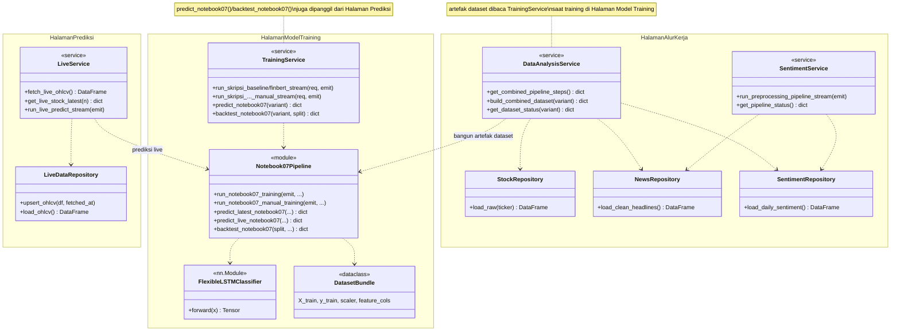

# Class Diagram — Backend, Dikelompokkan per Halaman FE

Versi paling ringkas — hanya kelas BE yang benar-benar dipanggil dari 3
halaman FE yang bisa dinavigasi (`ui-stock-prediction`): **Prediksi**,
**Model Training**, **Alur Kerja**. Kelas BE yang tidak dipakai halaman
manapun (mis. alur early-fusion lama, `ArtifactRepository`, `DataInformationService`)
dihilangkan total — lihat [`class_diagram.md`](./class_diagram.md) untuk
gambaran lengkap.

Karena `TrainingService` dan `Notebook07Pipeline` dipakai lebih dari satu
halaman, keduanya ditaruh di namespace halaman yang paling relevan lalu
diberi **note** menandai halaman lain yang juga memakainya — bukan diduplikasi.

