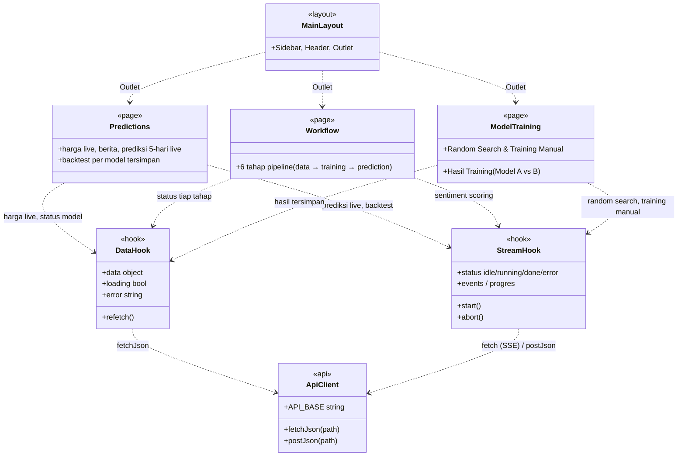

# Class Diagram — Frontend (`ui-stock-prediction`)

> Pelengkap [`class_diagram.md`](./class_diagram.md) (Backend + Model), yang
> sebelumnya sengaja tidak memuat lapisan frontend. Diagram ini dibuat
> berdasarkan pembacaan langsung UI yang berjalan di `http://localhost:5173`
> beserta kode sumber `ui-stock-prediction/src`.

## Cakupan

React tidak memiliki kelas dalam arti OOP klasik — halaman dan komponen
adalah *function component*, dan logika stateful hidup di *custom hook*.
Untuk kebutuhan UML, tiap kelompok direpresentasikan sebagai satu kelas
ber-stereotype, disederhanakan ke level **halaman** saja (bukan per
komponen kecil) supaya diagram tetap mudah dibaca:

- `<<page>>` — 3 halaman yang benar-benar dapat dinavigasi dari `Sidebar`
  saat ini: **Prediksi** (`/`), **Alur Kerja** (`/workflow`), **Model
  Training** (`/training`). Enam route lain masih terdaftar di `App.jsx`
  tetapi tautannya di-*comment-out* di `Sidebar.jsx` — diperlakukan sebagai
  halaman legacy, tidak digambarkan di sini.
- `<<layout>>` — kerangka bersama seluruh halaman.
- `<<hook>>` — seluruh custom hook diringkas jadi satu kelas `DataHook`
  (pola fetch-once) dan satu kelas `StreamHook` (pola SSE), karena
  ketujuhnya berbagi bentuk & tujuan yang sama persis.
- `<<api>>` — satu titik integrasi ke backend.

## Diagram

## Narasi

**Lapisan Layout.** `MainLayout` adalah kerangka tetap seluruh aplikasi —
menyatukan navigasi (`Sidebar`), judul halaman berjalan (`Header`), dan area
konten yang berganti sesuai route aktif (`Outlet` dari React Router).

**Tiga Halaman.** *Prediksi* menyatukan harga OHLCV live, berita terkini,
prediksi arah harga 5-hari-ke-depan (live, via SSE), serta backtest per
model yang sudah dilatih. *Alur Kerja* merepresentasikan pipeline
end-to-end sebagai enam tahap berurutan (data mentah → sentiment scoring →
agregasi harian → penggabungan dataset → training → prediction), status
tiap tahap diambil langsung dari backend, bukan state lokal buatan. *Model
Training* menyediakan dua jalur pelatihan (Random Search live dan Training
Manual satu konfigurasi) untuk dua model — LSTM-OHLCV dan FinBERT-LSTM —
plus tab hasil tersimpan yang membandingkan keduanya.

**Dua Pola Hook.** Semua state dan komunikasi ke backend mengikuti dua pola
yang konsisten di seluruh halaman: `DataHook` mengambil data sekali saat
komponen dimuat dan bisa di-*refetch* manual (dipakai untuk data
status/hasil tersimpan), sedangkan `StreamHook` menjalankan proses panjang
di backend (training, prediksi live, sentiment scoring) lewat Server-Sent
Events dengan mesin status `idle → running → done/error`. Keduanya
bermuara ke satu titik integrasi, `ApiClient`, yang menstandarkan alamat
backend, pengambilan data JSON, dan penanganan error — setara dengan peran
`FileBasedRepository` di lapisan backend menstandarkan akses penyimpanan.
