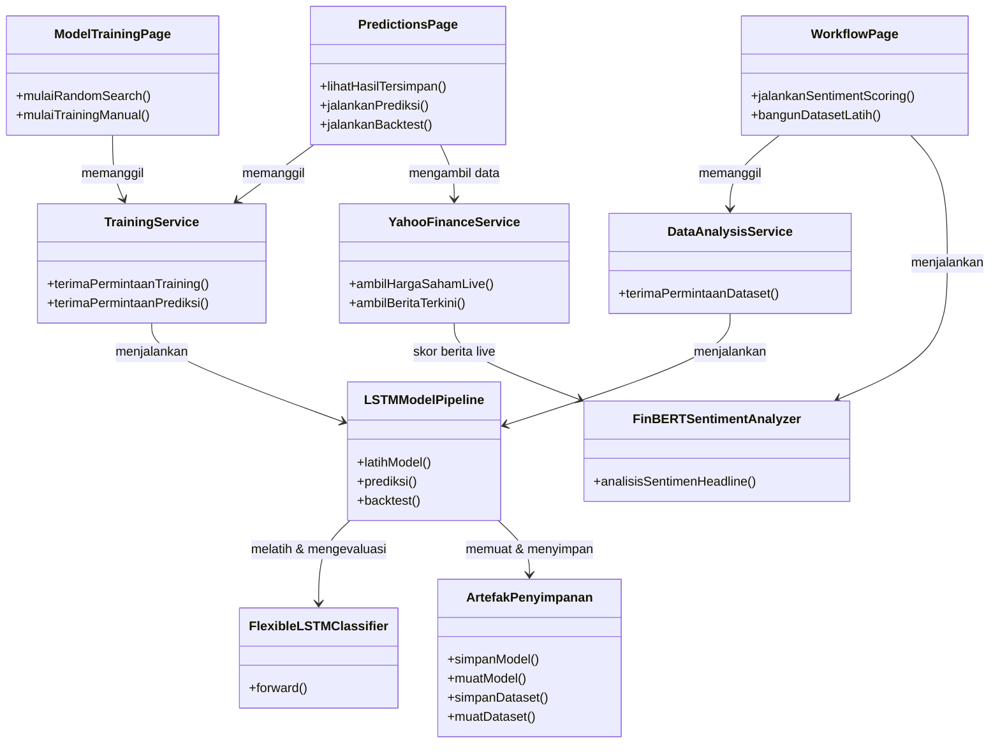

# Class Diagram — Alur Halaman → Service → Model (Gaya Sederhana)

Gaya diagram: tiap kelas cuma tampilkan nama + method (tanpa atribut, tanpa
stereotype), panah asosiasi diberi label aksi — mengikuti gaya referensi
(`ModelTrainingPage`/`PredictionsPage` → `Controller` → `Trainer`/`Model`).
Dipetakan ke arsitektur nyata backend `stock_prediction` (3 halaman FE yang
bisa dinavigasi: Model Training, Prediksi, Alur Kerja).

