# Class Diagram — Backend Stock Prediction (Versi Ringkas, untuk Cetak)

Versi ringkas dari [`class_diagram.md`](./class_diagram.md) — dipangkas supaya
muat 1 halaman kertas. Cara memangkas:

- 6 entitas Domain (`StockBar`, `Headline`, `SentimentScore`,
  `DailySentiment`, `PredictionResult`, `TrainingRun`) digabung jadi satu
  kelas `DomainEntity`; `TickerSymbol`+`DateRange` digabung jadi `ValueObject`.
- Atribut/parameter method dipangkas — hanya method paling representatif per
  kelas yang ditampilkan (bukan seluruh API publik).
- `LiveDataService` + `LivePredictionService` digabung jadi satu `LiveService`.
- `PredictionService`, `DirectionPredictor`, `LSTMDirectionClassifier` (alur
  early-fusion lama, di luar Batasan Masalah BAB I yang scope-nya Random
  Search `notebook07`) **dihilangkan** dari versi ringkas ini — detail
  lengkapnya tetap ada di `class_diagram.md`.

```mermaid
classDiagram
    namespace Domain {
        class ValueObject {
          <<value object>>
          TickerSymbol, DateRange
        }
        class DomainEntity {
          <<entity>>
          StockBar, Headline, SentimentScore, DailySentiment, TrainingRun
        }
    }

    namespace Repository {
        class FileBasedRepository {
          <<abstract>>
        }
        class StockRepository {
          +load_raw(ticker) DataFrame
        }
        class NewsRepository {
          +load_clean_headlines() DataFrame
        }
        class SentimentRepository {
          +load_daily_sentiment() DataFrame
        }
        class ArtifactRepository {
          +load_metadata(filename) dict
          +save_metadata(metadata, filename) Path
        }
        class LiveDataRepository {
          +upsert_ohlcv(df, fetched_at)
          +load_ohlcv() DataFrame
        }
    }

    namespace Model {
        class FlexibleLSTMClassifier {
          <<nn.Module>>
          +forward(x) Tensor
        }
        class DatasetBundle {
          <<dataclass>>
          X_train, y_train, scaler, feature_cols
        }
        class Notebook07Pipeline {
          <<module>>
          +prepare_dataset_bundle(...) DatasetBundle
          +run_notebook07_training(emit, ...)
          +predict_latest_notebook07(...) dict
          +backtest_notebook07(split, ...) dict
        }
    }

    namespace Service {
        class TrainingService {
          <<service>>
          +run_skripsi_baseline/finbert_stream(req, emit)
          +predict_notebook07(variant) dict
        }
        class SentimentService {
          <<service>>
          +run_preprocessing_pipeline_stream(emit)
        }
        class DataAnalysisService {
          <<service>>
          +get_stock_summary() dict
          +build_combined_dataset(variant) dict
        }
        class DataInformationService {
          <<service>>
          +get_regime_overview(model, horizon) dict
        }
        class LiveService {
          <<service>>
          +fetch_live_ohlcv() DataFrame
          +run_live_predict_stream(emit)
        }
    }

    FileBasedRepository <|-- StockRepository
    FileBasedRepository <|-- NewsRepository
    FileBasedRepository <|-- SentimentRepository
    FileBasedRepository <|-- ArtifactRepository

    StockRepository ..> ValueObject
    NewsRepository ..> ValueObject

    Notebook07Pipeline ..> FlexibleLSTMClassifier
    Notebook07Pipeline ..> DatasetBundle

    TrainingService ..> Notebook07Pipeline
    DataAnalysisService ..> Notebook07Pipeline
    DataAnalysisService ..> StockRepository
    DataAnalysisService ..> NewsRepository
    DataAnalysisService ..> SentimentRepository
    SentimentService ..> NewsRepository
    SentimentService ..> SentimentRepository
    DataInformationService ..> ArtifactRepository
    LiveService ..> LiveDataRepository
```

